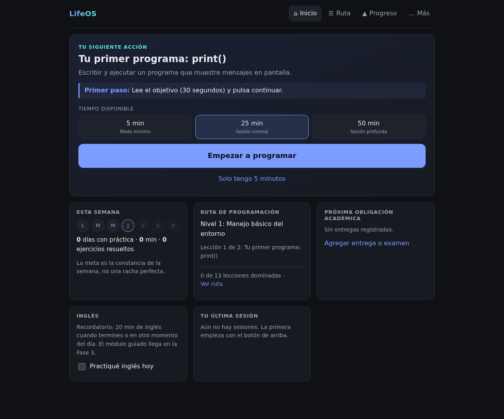

# LifeOS — Fase 1 (MVP)

Tu sistema personal para aprender a programar sin perder tiempo organizándote. Abres la app, pulsas **«Empezar a programar»** y empiezas una lección guiada con Python real en el navegador.



## Usarla

**En línea:** https://israel187-1.github.io/LifeOS-/ (se publica sola con cada cambio en `main` mediante `.github/workflows/deploy.yml`; requiere *Settings → Pages → Source: GitHub Actions*).

**En tu computadora:**

```bash
npm install
npm run dev        # http://localhost:5173 (desarrollo)
# o la versión compilada:
npm run build && npm run preview   # http://localhost:4173
```

Requisitos: Node.js 20.19+ o 22.12+ (Windows, macOS o Linux). La carpeta `dist/` ya compilada se puede subir tal cual a cualquier hosting estático (GitHub Pages, Netlify, Cloudflare Pages). Desde el teléfono, ábrela en Chrome y elige «Agregar a pantalla principal»: queda instalada como app y funciona sin conexión después de la primera carga.

> No abras `dist/index.html` con doble clic (`file://`): los navegadores bloquean el Web Worker de Python. Hace falta un servidor (`npm run preview` o un hosting).

### Flujo de uso

1. **Inicio** muestra una sola acción prioritaria, el primer paso concreto y el tiempo disponible (5 / 25 / 50 min).
2. **Empezar a programar** abre la sesión guiada. Una lección completa tiene estos pasos: objetivo → concepto → ejemplo paso a paso (con puente PSeInt → Python) → ejercicio guiado → errores frecuentes → corregir un bug → ejercicio independiente → preguntas de recuperación → mini-reto → explicación con tus palabras (Feynman) → resumen y siguiente paso.
3. **Ejercicios**: escribes Python, pulsas *Ejecutar* o *Comprobar* y ves la salida, las pruebas una por una, la diferencia entre lo esperado y lo obtenido, y los errores de Python explicados en español. Las pistas son progresivas. La solución solo se desbloquea después de intentarlo y de usar todas las pistas, y en ese caso el ejercicio no cuenta como resuelto de forma independiente.
4. **Dominio**: una lección se marca como dominada solo si cumples tres cosas: resolver el ejercicio independiente sin ver la solución, acertar al menos 2 preguntas de recuperación y escribir tu explicación. Leer el contenido no cuenta.
5. **Solo tengo 5 minutos** abre una sesión mínima con una sola actividad (un ejercicio, un bug, repasar tres preguntas o una explicación).
6. **Interrupciones**: todo se guarda mientras avanzas. Si cierras la app, el botón principal cambia a «Continuar donde lo dejé». Si pasan 3 o más días sin práctica, la app propone una sesión de regreso breve y fácil, sin mensajes de culpa y sin borrar nada.
7. **Ruta**: muestra los 16 niveles. No puedes saltar un nivel sin aprobar una prueba de nivel, y si la apruebas no tienes que repetir sus lecciones.
8. **Progreso**: muestra la constancia semanal y mensual (días con práctica, minutos efectivos, ejercicios intentados y resueltos, conceptos dominados, días sin práctica y tiempo entre sesiones), además del historial.
9. **Más**: incluye el asistente de decisiones con reglas locales (sin IA conectada, y lo dice), las entregas y exámenes, la lista de espera de ideas, y exportar, importar o borrar datos.

## Decisiones técnicas

| Necesidad | Decisión | Por qué |
|---|---|---|
| Interfaz | React 19 + TypeScript + Vite, PWA | Funciona en Android y Windows, se instala y trabaja sin conexión |
| Datos | IndexedDB local + espejo síncrono en localStorage, exportar/importar JSON | Para un solo usuario no hace falta cuenta ni servidor. Tus datos no salen del dispositivo. `StateRepository` (`src/data/storage.ts`) es el punto donde se conectaría una API + PostgreSQL para sincronizar entre dispositivos |
| Ejecutar Python | Pyodide (CPython en WebAssembly) dentro de un Web Worker | El código nunca se ejecuta en un servidor: queda aislado en el sandbox del navegador. Un límite de pasos detiene los bucles infinitos y, si el worker no responde, se reinicia por tiempo |
| `input()` | Las entradas de cada prueba se pasan por adelantado | Así los ejercicios con entrada se pueden calificar automáticamente |
| Asistente | Reglas locales (`src/domain/assistant.ts`) | No hay IA conectada y la interfaz no lo simula |

Estructura: `src/domain` (lógica pura y probada), `src/content` (niveles y lecciones), `src/python` (worker, arnés, errores y calificación), `src/data` (persistencia), `src/state` (store de React), `src/ui` (pantallas).

## Pruebas

```bash
npm run typecheck   # TypeScript
npm run lint        # oxlint
npm test            # Vitest: dominio, persistencia, asistente y validación de contenido
npx playwright install chromium && npm run test:e2e   # E2E en escritorio y móvil (Pixel 7)
```

- La **validación de contenido** ejecuta en Pyodide la solución de cada ejercicio de Python contra sus pruebas y comprueba que el código inicial *no* las pase.
- Las pruebas **E2E** cubren los 8 criterios de aceptación: lección completa con retroalimentación (fallo, error de sintaxis y acierto), dominio, persistencia tras recargar, retomar una sesión tras cerrar la pestaña, sesión mínima, siguiente paso recomendado, ausencia de desbordamiento horizontal en móvil y escritorio, y detención de un bucle infinito.

## Alcance actual y limitaciones

- **Lecciones completas:** niveles 1–7 (13 lecciones: entorno, lógica, algoritmos/PSeInt, fundamentos de Python, variables y E/S, condicionales y bucles). Los niveles 8–16 aparecen en la ruta como «próximamente».
- Los datos viven en un solo navegador o dispositivo. Para pasarlos de un dispositivo a otro, usa Exportar / Importar.
- La primera carga de Python descarga unos 10 MB. Después queda en caché.
- La revisión de la explicación Feynman busca ideas clave por palabras: es orientativa y no corrige como lo haría un profesor.
- El módulo académico de esta fase solo permite registrar entregas y fechas. Las calificaciones, los porcentajes y los escenarios llegan en la Fase 2. La app nunca inventa fechas ni notas.
- Inglés: por ahora solo hay un recordatorio y un registro diario. El módulo guiado llega en la Fase 3.

## Próximos pasos

1. **Fase 1.1:** lecciones de los niveles 8–10 (funciones, listas y diccionarios, depuración) y el primer proyecto guiado (calculadora).
2. **Fase 2 (universidad):** materias editables, evaluaciones con peso, promedio actual, escenarios («¿qué necesito en el final?»), impacto de cada evaluación, sesiones de estudio antes de exámenes y temas que no comprendo.
3. **Fase 3:** inglés con repaso espaciado, proyectos con etapas y criterios de finalización, límite de proyectos activos y portafolio.
4. **Fase 4:** recomendaciones adaptativas, análisis de progreso y una integración opcional con IA detrás de una interfaz explícita.
